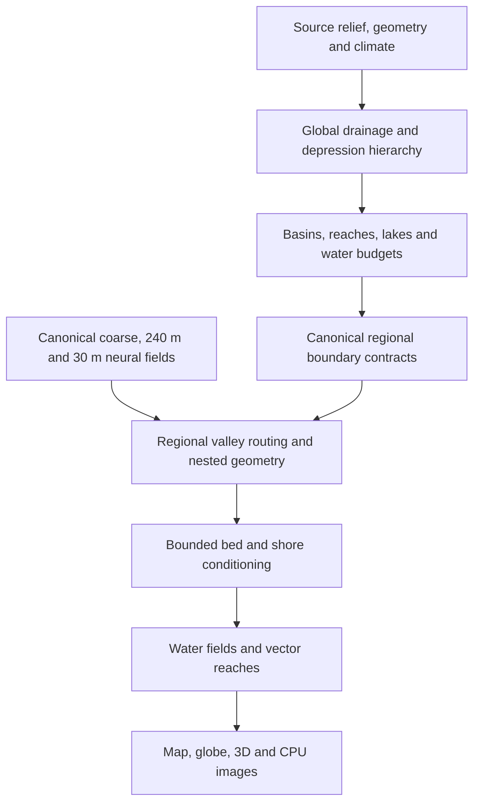

# Multiscale hydrology for Neural Earth

Status: river stack implemented and the reference neural scene checked live, 2026-10-21. This document retains the wider design scope; the [integration note](../methods/hydrology-integration.md), [verification results](../methods/hydrology-verification.md) and individual [method notes](../methods/) describe the delivered algorithms and their limits. Lake rendering is deferred at the user's request. Bars, oxbows, distributaries, monthly lake storage and standalone WASM execution remain later work.

Companion: [French literature and project review](hydrology-literature.fr.md).

Current scope adjustment (2026-10-21): lake rendering is deferred at the user's
request after close-zoom inspection. Depression/lake nodes remain in drainage
and water budgets, but neither lake polygons nor their water surfaces are
delivered to the viewer. Work and visual acceptance focus on rivers.

Interactive performance adjustment: the default draws the global network and
adds local vector routing on already-generated Base. It preserves raw neural
heights and introduces no extra neural inference. Full profile fitting and
channel carving, plus every cosmetic treatment, are opt-in and disabled by
default. The physical composition design below describes that detailed mode.
See the [current delivery contract](../methods/hydrology-integration.md#interactive-default-and-optional-detail).

## Decision

Build one geographic drainage hierarchy, then refine it on demand in fixed drainage units against canonical neural terrain. Display tiles are consumers of this hierarchy. They never independently decide where a river drains. Global basin membership, downstream connections and water budgets remain authoritative; local topology is added at 240 m, while 30 m supplies geometry, banks and channel detail without another drainage topology.

Use the current Python backend with NumPy, SciPy and Numba, already in the locked environment, and JavaScript/WebGPU for presentation. Start with compact arrays and a few modules. Do not introduce a GIS server, a new native build, an ML training programme or planetary hydraulic simulation. A native kernel is an option only after profiling identifies an actual CPU bottleneck.

### Accepted implementation refinements from the user

The coarse model can differ substantially from base reconstruction. Preserve its large physical cells and basin/corridor envelopes explicitly through coarse -> base -> decoder; do not replace coarse authority by a new drainage solve on each finer DEM. Anchor crossings to the parent cell/feature hierarchy. Represent base and decoder contributions as spatially aligned detail relative to their parent, with physical channel constraints re-applied after refinement. Validate these three stages separately on the same geographic footprint, including an intentionally shifted base valley.

Some humid low-gradient tropical alluvial reaches should optionally have nested bends: a broad wandering channel belt containing successively smaller bends, bars and secondary channels. Bands use persistent reach stations and physical wavelengths, never screen LOD or a fresh random draw. Far views integrate the wet coverage of this belt, which can look wider than the resolved close channel; they must not paint the entire floodplain as open water. This morphology is sparse, confinement/climate-gated and secondary to the working network.

### Initial worker interface

All coordinates are geographic map metres, y increasing southward; height/water in metres; contributing area in square metres; flow in cubic metres per second. Arrays are NumPy, records are small dictionaries. The initial core function is `build_hydrology(height_m, *, bounds, seed=0, topology='sphere', runoff_mm_year=None, evaporation_mm_year=None, ...) -> HydroWorld`. The result exposes `height_m`, `filled_m`, `receivers`, `order`, `area_m2`, `discharge_m3s`, `basin_ids`, `lake_ids`, `ocean`, `reaches`, `lakes`, `bounds`, and `metadata`. A reach record has stable `id`, `source`, `target`, `basin_id`, `xy` (N by 2), `water_m` (N), `flow_m3s`, `area_m2`, and `downstream_id`. Lake records have `id`, `level_m`, `closed`, `area_m2`, and flat `cells`; shoreline rings are geometry output. Renderer/service serialization converts arrays at the boundary. The geometry module accepts array/record inputs without importing the server, and the balance module is pure physical calculation. Changes to this shared interface are coordinated before another worker consumes them.

## What the repository actually supplies

- `backend/terrain_orogen_stages.py` retains immutable relief, erosion and climate stages. Its relief artifact includes spherical `points` and `triangles`; the physical atlas is 2048 by 1024. The atlas spacing is about 19.53 km at the default equatorial scale. It is not the spacing of the underlying Orogen mesh: `orogen_detail` defaults to 100,000 regions.
- `native/orogen/vendor/terrain-post.js` and the optional CUDA/City erosion paths compute drainage internally. These are erosion work arrays, not a persisted final river network. Receiver arrays from an intermediate erosion iteration cannot simply become final hydrology: elevation, hypsometry, selected erosion and geometry may subsequently differ, and accumulated cell counts are not climatic discharge.
- `backend/terrain_conditioning.py` supplies elevation, BIO1, BIO4, BIO12 and BIO15 through the selected source adapter. Orogen also retains two seasonal temperature proxies and half-year rainfall totals. `backend/terrain_climate.py` can sample the learned coarse climate. Two seasonal totals do not determine real monthly rainfall.
- Neural resolutions are coarse 7680 m, latent reconstruction 240 m and decoder 30 m. Display LOD uses `30 * 2**lod` metres, from LOD 11 to -6. Sampling a coarse field at 480 or 1920 m does not create terrain learned at those resolutions.
- `backend/terrain_server.py` already provides scheduling, physical tile delivery and parent previews. `terrain_refinement.py` adds experimental detail below 30 m. The final terrain depends on physical generation settings, including relief controls; routing must not use whichever preview happens to be cached.
- `terrain_polar.py` uses a separate rotated neural chart. Its input noise and conditioning coordinates differ from the geographic chart. `terrain_manifest.py` also explicitly marks learned terrain as non-periodic in longitude, even when the source atlas wraps. Hydrology must not treat a camera's current chart or a source seam convention as proof of neural continuity.
- Current water classification is largely elevation below zero in `terrain_render.py`, `terrain_render_torch.py`, `web/terrain_renderer.js` and the in-progress `web/terrain_render3d.js`. Continental lakes above zero and closed depressions below sea level need explicit water classes.

The local reference is `../city_generator`, inspected at HEAD `1d245aa` with its current working files, rather than only the pinned `native/magna-urbis` snapshot `08f3e61`. Useful methods are in Rust `hydrology*.rs`, bridge `hydrologySurface.ts` / `hydrologyRender.ts`, TypeScript `riverVectors.ts`, and `web/src/render/terrainWater.ts`. The finite-square orchestrator, grid-index IDs, border outlets and per-cell thresholds must not be copied as world-scale contracts.

## 1. Global authority: final source, drainage and lakes

The first implementation uses one final physical source raster through the common conditioning adapter. This handles Orogen, imported/native and procedural sources consistently, including the selected erosion output. Reconstruct drainage rather than exporting a possibly stale Orogen erosion graph. Existing retained spherical geometry may help later; it is not a prerequisite or a second hydrology implementation.

Run deterministic Priority-Flood with a FIFO depression queue, retain depression labels and spill elevations, resolve flats by rank rather than random altitude perturbations, then accumulate physical contributing area. Preserve substantial depressions in a hierarchy instead of filling every depression out of the landscape. These are adaptations of [Barnes, Lehman and Mulla, 2014](https://arxiv.org/abs/1511.04463) and [Barnes, Callaghan and Wickert, 2020](https://esurf.copernicus.org/articles/8/431/2020/). The routing surface and the physical ground are distinct arrays.

Spherical routing wraps longitude, uses geodesic edge lengths and exact latitude-band cell areas:

`area = R² * delta_longitude * (sin(latitude_north) - sin(latitude_south))`.

The pole is a shared geographic node, not a row of independent outlets; a plane uses Cartesian lengths, cell area and explicit finite-domain boundary conditions, without longitude wrapping. Raster anisotropy is acceptable for this hidden macro skeleton; final river vectors do not expose its D8 edges. Near-pole metric behaviour is a required prototype check, not assumed solved by longitude wrap alone.

An ocean mask starts from designated open-sea components of the source water mask. Inland negative depressions remain candidates for lakes or dry basins. A dry world uses terminal closed basins; the algorithm must not invent a sea outlet. Planar edge outlets are an explicit world boundary convention, never the edge of an arbitrary requested tile.

Collapse paths into reaches between sources, confluences, lake entries/exits and mouths. Store basin IDs, downstream IDs, contributing area, length, Strahler order, elevation constraints and physical water budgets. A lake is a node with one level, connected wet footprint, spill sill, hypsometry and either an outlet or a terminal basin. There is a topological link through a lake, but no visible river ribbon across its surface.

Use the depression hierarchy and a modest water balance inspired by [Fill–Spill–Merge, 2021](https://esurf.copernicus.org/articles/9/105/2021/): storage fills, spills at a sill and merges with adjacent filled depressions. The initial annual equilibrium is deliberately smaller than the published dynamic model. Closed lakes balance inflow against evaporation/infiltration; wet basins can spill, arid basins can remain dry. Record convergence and residuals instead of copying Magna's fixed iteration counts as proof of equilibrium.

## 2. Regional refinement, boundary ownership and LOD

The fixed unit of hydrological ownership is a reach's incremental catchment: source cells whose water first joins the selected network on that reach. Lakes have their own units. These units come from the global pass, never the viewport. Long or broad units are partitioned along the trunk into fixed budgeted pieces before any fine job runs. Square tiles are only terrain windows and cache blocks. Target a bounded latent footprint around 256-512 square samples at 240 m per piece; subdivision must cap sampled area, not merely count source cells. Narrow masks can use several windows rather than their enormous empty bounding box.

There is no extra routing hierarchy on an interpolated 1920 m grid. The actual 7680 m neural coarse field, already required for latent reconstruction, guides the 240 m unit job. This removes a level of interfaces that would add no learned information. The source pass determines global basins and water budgets; 240 m adds local tributaries and small lakes; 30 m only refines geometry and physical sections.

Each global network node has a pure, shared 240 m anchor artifact. A cut between two pieces of the same drainage unit has a shared cut artifact, keyed by hydro identity, cut ID and resolution. Its deterministic fixed strip intersects the parent's trunk corridor: choose an admissible low station, fit its descending height interval and tangent from a fixed neighbourhood, and freeze the result. Upstream and downstream pieces read this same portal, even when only one is requested. Heights are solved with the parent node constraints; an inconsistent interval is a physical conflict, not permission to change a neighbour's node. IDs and tie order do not depend on request order.

Inside each piece, find a valley-following trunk path within the inherited corridor, penalizing incision, excessive deviation and sharp curvature. Route local terrain toward that trunk with Priority-Flood and ranked flats. The parent unit labels constrain watershed membership. Only declared trunk cuts exchange flow between pieces; local channels are routed to their unit trunk, rather than drawn and clipped at a window edge. Ancestral basin boundaries are an explicit approximation to true fine divides. Measure how often fine downhill gradients disagree with them; if that produces long artificial channels along divides, the prototype fails its realism gate. Do not market constrained labels as the exact fine DEM watershed.

Additional tributaries are computed once over the complete budgeted 240 m piece. They cannot independently invent a cross-piece outlet or steal another parent's area. A new confluence splits a parent reach while retaining its lineage. At 30 m, use the fixed 240 m graph and refine only visible corridor windows. There is no 30 m receiver field, new basin partition or globally accumulated headwater graph. Sub-240 m channels are geometric/morphological detail, not newly discovered hydrological catchments.

An extensive parent lake has one level and one parent shore field across all pieces. Local terrain refines this field inside its declared shore envelope; it never computes a separate water level or clips a lake because a tile ended. This is a procedural downscaling of the lake, not an exact flood-fill of unknown global fine terrain. A new local lake can become an owned 240 m object only when its full connected component and closed dry boundary fit in its fixed computation domain; a component touching an unknown boundary remains a parent-level water feature, not a fabricated closed pond.

[Barnes's tiled Priority-Flood, 2016](https://arxiv.org/abs/1606.06204) motivates the wider boundary graph. Our lazy model deliberately solves against inherited constraints, not the exact globally decoded 30 m DEM. A rendering halo cannot establish a watershed, lake level or upstream discharge. It only covers bounded interpolation, geometry, incision and rasterization kernels.

For a fixed hydro identity, all artifact inputs and domains are fixed. Missing dependencies schedule those dependencies, never a different calculation on whatever preview is cached. Heights, water and geometry publish together; failed/cancelled jobs publish nothing. While work is pending, the parent line is connected through the canonical portals. A diagnosed difficult reach receives a complete fallback package, rather than leaving an indefinite loading preview.

Screen LOD selects and tessellates the same geometry; it never reseeds it or reruns migration. Fine tributaries appear progressively while downstream trunks remain connected. A parent preview can move within its declared corridor when true detail arrives; exact pixel invariance before fine terrain exists is not promised. [IHU, 2021](https://hess.copernicus.org/articles/25/5287/2021/) informs preservation of connections and channel properties; it is upscaling of existing fine hydrography, not a solution for generating unknown fine rivers.

## 3. Realistic vectors and a coherent physical surface

Adapt the local Rust approach: continuous physical offsets, bounded Hermite tangents and adaptive subdivision, plus admissibility checks against valley floor, banks, lakes and neighbouring channels. Index every random value by world seed, persistent reach ID, hierarchy level and physical station along an anchored course. Never use tile-local cell indices, viewport bounds or display LOD as a random seed.

Curvature and width depend on slope, discharge and confinement. Steep or incised reaches stay relatively direct; broad low-gradient floodplains get irregular bends at multiple wavelengths. Flat terrain does not automatically get a sinusoid. Retain exact shared node positions and tangents; limit displacement near confluences and lake outlets. Validate full spline spans against terrain/obstacles, not just vertices, and use a spatial bin index for intersections. Simplification pins portals and nodes and checks that shortcuts stay inside the corridor without introducing crossings.

This combines Magna's proven local ideas with the river/terrain composition described by [Génevaux et al., 2013](https://perso.liris.cnrs.fr/eric.galin/Articles/2013-river-networks.pdf) and water/bed geometry ideas from [Peytavie et al., 2019, Procedural Riverscapes](https://diglib.eg.org/items/555e713d-c93f-4c7c-987e-674f7153d34d). It does not reproduce their full terrain construction or blend-flow-tree animation systems.

Magna's iterative TypeScript migration and [meanderpy](https://github.com/zsylvester/meanderpy) are useful morphology references for bends, bars and oxbows. Repeated historical migration, hundreds of iterations per view and full sediment dynamics are deferred. The geometry block first delivers the main channels, then adds sparse static secondary channels, bars, oxbows and eligible coastal distributaries. Flow splits use explicit fractions whose sum is one and retain an acyclic downstream graph. These morphological additions are part of the proposed rendering stack, without claiming sediment transport or a tidal delta simulation.

Compute a monotone non-increasing water profile between inherited elevations; flat water is permitted for lakes. Derive bed/bank envelopes with compact physical support, inspired by Magna's surface composition. Store fixed upper/lower admissible heights U and L from the raw canonical inputs, with L <= U. The projection `Phi(h) = max(L, min(h, U))` is idempotent; a repeated additive incision is not. Raw neural cache entries stay immutable. The conditioned terrain is a separate physical product, never fed back as the next raw routing input.

Provide two explicit read paths: raw canonical height for planning and conditioned height for consumers. The order is raw input, chart/seam reconciliation, physical projection, hydro-namespaced committed tiles and final mips, optional display relief/filtering, then a consistent projection at that display sampling. Compute delivered physical statistics and water classes from the final delivered field. No consumer infers ocean solely from a bed height below zero. Construct coarse admissible envelopes from the continuous physical section and coverage; do not blindly combine minimum upper bounds and maximum lower bounds if that would make L exceed U. At far LOD >= 4, use water coverage/vectors and explicitly approximate terrain rather than promising resolved riverbed geometry.

A mip of committed conditioned children and an independently sampled preview are different quality states, never interchangeable cache hits. Sub-30 m detail receives the same water constraints after refinement. Use double-precision geographic/local positions and shared local origins for float32 GPU offsets. Regional path costs respect the chart's sampling metric; physical areas, discharge, section widths, lengths and slopes used for river properties use spherical/local-tangent distances. Convert widths into the selected chart at rasterization, rather than interpreting equatorial map metres as true metres at all latitudes.

The neural models do not guarantee macro valleys or coast positions. Immutable topology, an untouched neural DEM and universally small corrections cannot all be guaranteed. The priority is basin connectivity, then terrain-following within a parent corridor, then small incision. The deterministic fallback sequence is alternative paths, bounded incision, a feasible connected impoundment within the owned unit, then an explicitly flagged stronger channel correction. Every stage has recorded maximum incision/extent; no correction is silent and the package is complete. A flagged gorge is a diagnosis, not automatic visual acceptance. If strong corrections or divide artifacts are common, the initial prototype fails and we revise the corridor or upstream terrain-conditioning policy before expanding implementation.

Mouths use a canonical coastal strip to meet the chosen learned shoreline within their parent outlet corridor. A changed continent/island topology outside that corridor is a physical conflict, not a cosmetic endpoint adjustment. Closed-lake levels cannot be recomputed from each tile's minimum. Refine contours against a connected shore field with one owner and preserve holes/islands.

Below 30 m, deterministic procedural bed and bank detail is evaluated from the same river surface function; existing terrain refinement must be attenuated in wet channels and lake footprints. It may not introduce a dam or change a lake's classification. Such detail remains procedural, not learned bathymetry.

### One geographic authority across neural charts

The same seed can have different neural detail in the ordinary and rotated polar charts. A coordinate transform alone cannot reconcile them. Define one physical height sampler by geographic position: ordinary chart outside the polar belt, rotated chart inside, with a fixed overlap (initially 58-62 degrees latitude) and deterministic smooth blending. Ownership at the corner with the antimeridian is fixed too. Routing, map, globe and exports all query this sampler. In particular, the ordinary map must resample the canonical polar terrain in that belt; this is required integration work, not an optional approximate overlay. No basin changes because the camera crosses 60 degrees.

At the ordinary chart's antimeridian, use a canonical strip built from both fixed edge windows, with a deterministic two-sided correction tapering into their interiors. Both sides query the same strip and channel profile; no dependence on beyond-domain neural reads is assumed. The strip width covers the corridor and projection/filter support. Restrict joins/ownership changes within these strips to shared artifacts, never independent worker decisions. Check whether the required height reconciliation is acceptable before claiming continuity. Natural/noise sources are not guaranteed periodic either: their spherical completion must be explicit in the global hydrology input. This does not retroactively claim that untouched raw neural caches are periodic. Poles are ordinary geographic terrain with possible depressions, never artificial drainage outlets or walls.

## 4. Climate, discharge and useful river information

The first network carries mean annual discharge from spatial runoff rather than a global wetness multiplier. The next delivery adds 12 climatological months, with rainfall, temperature, snow storage/melt, a small soil store, groundwater recession and lake storage. States are warmed through repeated synthetic years to a reported tolerance; changing the displayed month queries saved state and geometry rather than rebuilding drainage.

Use the selected physical climate adapter. For Orogen, retain its actual half-year rain totals and the existing temperature harmonic; do not reinterpret them as monthly extrema. If only BIO1/BIO4/BIO12/BIO15 exist, monthly phase is not identifiable. Any synthetic seasonal reconstruction must be labelled and have an explicit phase convention. The first seasonal version can use the existing two-half-year convention rather than manufacture monsoons. Fine climate and altitude may distribute subregional wetness, but never add an uncounted second water source.

A small documented temperature/latitude evapotranspiration estimate can use [Oudin's method](https://webgr.inrae.fr/eng/tools/hydrological-models/evapotranspiration-model); snowmelt can use a temperature-index approximation ([Hock, 2003](https://doi.org/10.1016/S0022-1694(03)00257-9)). The soil/recession store is an explicit project adaptation, not a claim to implement calibrated HBV or GR4J. Lake evaporation and transmission loss remain approximate parameters. Unlike Magna's minimum runoff floor, dry cells can produce zero runoff, and arid reaches can lose flow.

At each accounting unit, with volumes in cubic metres per month:

`delta_storage = precipitation + upstream_inflow - evapotranspiration - transmission_loss - downstream_outflow`.

`Q_m3_s = downstream_volume / seconds_in_month`.

Water accounting uses physical areas and disjoint lateral catchments. When a parent is refined, its lateral budget is partitioned, not added again to its already accumulated upstream flow. Child areas sum to the parent area, and child routed volumes reconcile at every parent portal. Displaying only a subset of upstream regions cannot change outlet discharge.

Global budgets are authoritative coarse-model estimates. Each unit has a fixed net lateral yield per month. Partition that yield over its complete 240 m domain using normalized non-negative fine climate/area weights; if all weights vanish, use parent area weights, and if parent yield is zero, add no water. Cuts receive their shares before refinement. Channel visibility uses monthly flow thresholds as well as contributing area, so dry land need not carry permanent blue lines.

New sub-source-scale wet depressions initially act as connected flow-through lakes; arid dry depressions are playas. They add no independently subtracted evaporation or planetary storage in v1. Their explicit zero additional loss allocation avoids hidden changes to distant discharge as regions are visited. Macro lakes retain the actual modeled storage/evaporation balance. More accurate local-lake accounting requires a deliberate new hydro revision with reconciled parent budgets, not a view-order-dependent discovery update. This conservative downscaling is within the model, not an exact water balance of unknown global neural terrain.

Expose basin area and hierarchy, river length, slope, flow direction, monthly discharge, annual mean, minimum climatological monthly flow, dry months, estimated water depth and downstream access. Do not call the minimum of 12 synthetic months a measured Q95, QMNA5 or flood return statistic. Unobserved glacier mass balance, aquifer geology and storms are outside this design.

Bankfull width/depth use an explicit regional empirical prior, with calibration ranges recorded. Wet sections vary by monthly discharge; exposed bed and bars grow at low flow. A normal-flow estimate may use Manning's relation `Q = A * Rh**(2/3) * sqrt(S) / n` on suitable sloping reaches ([USGS reference](https://wwwrcamnl.wr.usgs.gov/sws/fieldmethods/Indirects/rantz.htm)). Do not invert it at zero slope or apply it as a backwater/estuary solver.

Navigability is a derived seasonal worldbuilding property: vessel draft, usable width, current, falls/rapids, shallow bottlenecks and continuous downstream connectivity to a lake/sea/port. Store the limiting reach and reason. A large river may be blocked by one waterfall; a short deep segment does not make a navigable route. Classes and vessel thresholds are explicit heuristics.

## 5. Data, integration and performance

Keep four records, backed by typed arrays and small JSON metadata:

| Record | Minimum contents |
| --- | --- |
| Hydro world | Source/model/settings references, algorithm version, geometry, ocean components, canonical basin/receiver arrays, budgets |
| Reach | Stable ID and ancestry, node IDs, downstream connection, basin, contributing area, physical stations, width/depth priors, monthly flows |
| Lake | Stable ID/owner, pit/sill/outlet, level or monthly levels, connected shore field, hypsometry, budget and closure flag |
| Region | Fixed extent and resolution, parent/boundary references, reached geometry, local labels, surface modifiers, readiness/conflict status |

Use `hydro_id = hash(terrain_identity, physical_hydro_parameters, algorithm_version, chart_rule)` and a separate appearance key. The unconditioned terrain namespace remains the source of truth. Integrating through the currently source-hashed server may invalidate existing transport caches once; preserving raw neural data requires an explicit separation at that boundary, not just declaring two hashes. No simultaneous cache schema rewrite is planned.

Physical packages carry coverage, water class, water surface/depth, flow direction and shore-distance data as needed. A single documented water-material contract is mirrored in NumPy, Torch and WGSL, with a tiny parity fixture. Render calm water, rapids, foam, depth, wet banks, inside-bend bars and riparian moisture from those fields. Reuse existing sea/lake/river palette rules from Magna. Ribbons terminate at lake shores and share confluence geometry. Far views aggregate coverage; close views tessellate the vector ribbon. Screen-width exaggeration is cartographic styling, not physical channel width.

Proposed modules are `backend/terrain_hydrology.py` (authority, records and cache), `terrain_hydrology_routing.py` (compiled array kernels and regional constraints), `terrain_hydrology_geometry.py` (curves, shores and physical modifiers), `terrain_hydrology_balance.py` (climate/water accounting), and `web/terrain_hydrology.js` (transport and shared drawing geometry). Keep endpoint changes in `terrain_server.py` small. Reuse `terrain_jobs`, delivery and existing caches; avoid a new scheduler. Names and file boundaries may be simplified during implementation.

CPU hydrology must not hold the serialized GPU inference lane. Terrain dependencies use the existing queue, cancellation and shared windows. Initially allow one or two hydrology CPU jobs and only visible/corridor dependencies; do not decode a whole watershed or planet at 30 m. The global pass is linear/log-linear in a fixed source grid; local work is bounded by the canonical region and spatially indexed corridor geometry.

Unmeasured targets on the documented local development machine: a warm source-atlas drainage build in a few seconds, under roughly 256 MiB additional active hydrology memory for the global pass; 256-512 square local grids in about 100-300 ms after input heights exist; cached local delivery below about 50 ms; water rendering below about 2 ms for a typical view. Record JIT startup and neural dependency time separately. These numbers are profiling goals, not a forecast of total first-view latency or a guarantee for arbitrary worlds.

## 6. Delivery, review and just enough verification

After the user's go-ahead, freeze the raw/canonical/conditioned height interfaces and make one vertical slice: a small connected drainage area with a confluence, lake and mouth, several 240 m units, and a visible 30 m corridor crossing adjacent LOD0 tiles. Include adjacent LOD transitions, then a bounded antimeridian case and a polar overlap case on map/globe. This must use the real neural terrain. Record correction sizes, divide disagreement, dependency latency and final appearance. Fix a modest sample of additional coarse/240 m units if the initial case looks unusually favourable; do not start an expensive decoded-world survey. Common strong gorges or artificial divide-following channels fail the gate, irrespective of unit-test success. Resolve that before parallel implementation.

Then organize CLI workers explicitly as `claude-opus-5-5 --effort high`, with exclusive files per worker and a recorded actual model. Four substantial blocks are sufficient:

1. Global routing, depression hierarchy, basin/reach/lake records and annual budgets.
2. Canonical regional contracts, deterministic refinement and conditioned terrain.
3. Nested vector geometry, water transport and map/globe/3D/CPU rendering.
4. Seasonal stores, river properties and navigability queries.

Blocks 2 and 3 can overlap after the vertical slice establishes their interface; block 4 consumes the existing records. The coordinating agent reviews each whole block, runs focused checks, inspects live captures, resolves integration issues and keeps changes out of unrelated dirty files. Workers do not concurrently rewrite the server or the large renderer. No coding workers start in this design phase.

Keep a small regression module plus a browser capture/check script. Essential checks are deterministic output after reversing region request order or clearing caches; exact boundary portal agreement; acyclic receivers and declared terminal basins; no unaccounted area/volume at confluences; flat/closed/overflowing lake cases; monotone water profiles against the conditioned bed; and unchanged topology through LOD. Check spherical area totals, antimeridian crossings, a polar overlap, finite plane edges and an actual shifted coastline. One deliberately incompatible ridge must exercise the honest failure path.

Visual acceptance uses fixed seeds and camera coordinates for mountain torrents, low-gradient alluvium, connected lakes, an arid terminal basin and a coastal mouth, compared with the local Magna reference at equivalent physical scale. Check LOD 6/3/0 and negative LOD, then map/globe and CPU/WebGPU. Look for grid-aligned corners, implausible straight joins, sine-wave repetition, floating/hidden water, lake-spanning river ribbons, clipped shores and abrupt width changes. Natural straight reaches are allowed; the target is absence of raster artifacts, not curvature everywhere. Save shared settings and a handful of reproducible captures. No broad new CI programme or generated snapshot farm.

Every implemented/adapted method gets a concise English note under `docs/methods/`: inputs/units, algorithm or equations, source and licence, actual deviations, deterministic identity, scale behaviour, limitations and the focused evidence. This design is the initial register; notes are written with their implementation rather than asserting future code exists.

## Literature and project choices

The links above identify primary methods. Additional comparisons, inspected on 2026-10-21:

| Reference or project | Use in this design | Explicit boundary |
| --- | --- | --- |
| [Cordonnier et al., 2016](https://doi.org/10.1111/cgf.12820) | Drainage/relief consistency and stream-power context already relevant to Orogen | Do not regenerate neural continents with a second tectonic/erosion simulator |
| [PyFlwDir](https://github.com/Deltares/pyflwdir), MIT | Inspect/adapt compact NumPy/Numba routing, basin/order and HAND ideas; attribute any reused code | Its default edge outlets and raster assumptions do not implement our spherical/lazy contracts |
| [RichDEM](https://github.com/r-barnes/richdem), GPL-3.0; [FillSpillMerge reference](https://github.com/r-barnes/Barnes2020-FillSpillMerge) | Algorithm/reference comparison for Priority-Flood and depression handling | Do not make the C++ toolchain a default runtime dependency; preserve the specific reused file's licence |
| [pysheds](https://github.com/pysheds/pysheds), GPL-3.0 | Independent small reference for drainage/accumulation on finite fixtures | No need to install a second full hydrology stack |
| [meanderpy](https://github.com/zsylvester/meanderpy), Apache-2.0 | Morphological inspiration and optional offline comparison | No historical migration solver in the interactive path |
| [Red Blob mapgen4](https://github.com/redblobgames/mapgen4), Apache-2.0 | Compact mesh/reach data structures and readable procedural design | Its river/terrain authoring order does not preserve an existing neural DEM |
| [Davis, 2026, Plate-Local River Generation](https://arxiv.org/html/2610.00301v1), [toy projects](https://github.com/Davismk3/plate-local-river-generation) | Recent, relevant example of bounded regional caching and monotone channel/terrain composition | A preprint, not a demonstrated Neural Earth integration; rivers explicitly do not cross plate boundaries, so it cannot be the global drainage solution |
| [Unified river/DEM LOD, 2024](https://www.frontiersin.org/journals/environmental-science/articles/10.3389/fenvs.2024.1397798/full) | Related work on keeping vector and terrain simplification compatible | No replacement TIN renderer or full paper implementation proposed |

Any copied implementation must record the exact upstream revision and notices at implementation time. The local Magna reference is newer than the embedded inference submodule: copying selected methods does not authorize moving that submodule pin or changing pretrained model weights.

## Design collaboration record

Three read-only CLI reviews completed successfully with actual model `claude-opus-5-5`, requested effort `high`, and only `Read,Glob,Grep` tools. Sessions: architecture `6ece209d-91aa-4164-b6d5-f8594d2d2461`; Magna reuse `8a15673a-bc31-402d-88b2-7439b40eddc3`; adversarial synthesis `80db9fa6-093e-4507-add1-84be4a5fc1ec`. All reported success and no permission denials. Raw prompts and JSON results are retained outside Git in the runtime research folder.

Accepted from the final review: reach-catchment ownership instead of square-domain ownership; topology ending at 240 m; shared cut/node artifacts; mandatory canonical map/globe physical sampling; idempotent physical envelopes; explicit treatment of fine-lake budget approximation and complete fallback packages. Rejected: preparing the entire learned coarse world by default; exporting intermediate erosion receivers as final hydrology; polar outlets/walls; claiming unknown 30 m topology is exact; accepting arbitrarily deep gorges just because they are flagged; and a large random full-decoder validation campaign before useful integration. Mesh/atlas confusion and the claim that staged Orogen discards all retained geometry were corrected against the current code.

The coordinator chose these tradeoffs after the reviews. Implementation, benchmark measurements and visual acceptance remain future work.
