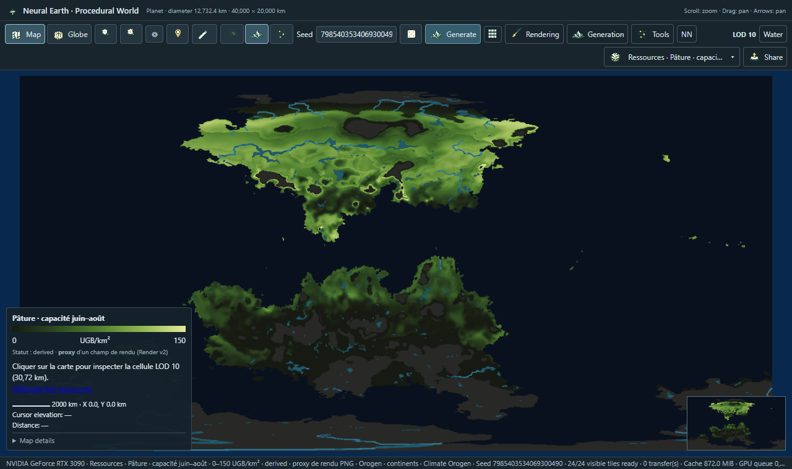
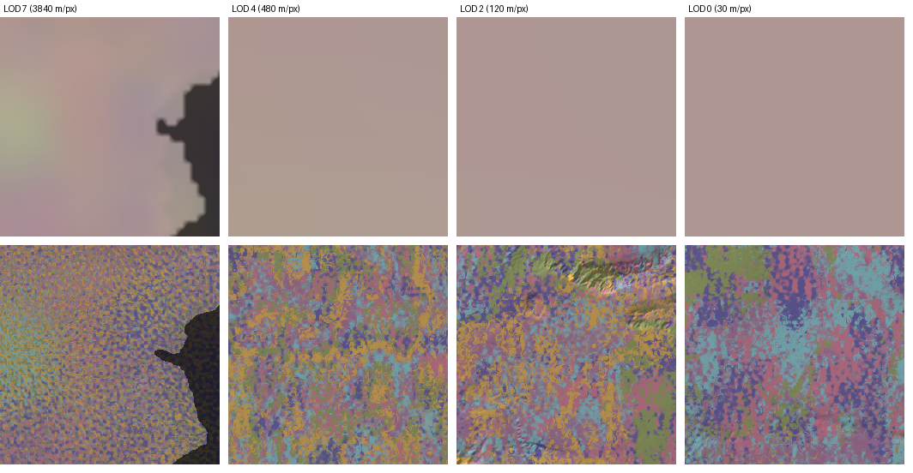

# Neural Earth layers

Choose a layer from the menu next to the map controls. Map and globe share the selected layer and physical terrain cache.

| View | What it shows |
| --- | --- |
| Relief | Height-colored shaded terrain |
| Render | Climate-informed soil, vegetation, rock, snow and water materials |
| Render3D | Render at distance; per-pixel ground, stands and tree crowns as you zoom, down to 1/128 m per pixel ([method](render3d.md)) |
| Render3D Brush | Render3D with painted overhead crowns and shrubs |
| Soils | Exposed soil and rock, with terrain shading |
| Pedology | Regional soil-mixture provinces on an approximately 200 km source grid |
| Biomes | Source Köppen class colors adjusted to current DEM altitude, slopes and coastlines |
| Köppen | Categorical climate classification |
| Annual temperature / precipitation | Climate diagnostics with physical units |
| Seasonal climate | Northern summer and winter temperature and half-year rainfall |
| Atmospheric layers | Pressure, wind direction/speed, rain shadows and ocean influence |
| Ocean layers | Seasonal surface current direction and speed |
| Orogen layers | Plates, superplates, crust, boundaries and convergence |
| Relief formation | Initial relief, uplift, orogeny, hotspots, back arcs, folded ridges and erosion changes |
| Resources (informative, French labels) | 121 views in six groups: geology (tectonic context and 8 rock classes), deposits (16 family prospectivities, discrete deposits, contained and medieval-recoverable stocks per metal), agriculture and herding, forest/wildlife/fisheries/water, materials/salt/peat, and four seasons. Each legend states unit, status (derived/synthetic) and *proxy* when a value comes from a Render v2 appearance field; a click inspects the 30.72 km LOD-10 cell ([method](RESOURCE_LAYERS.md)) |
| Map styles | Parchment, Atlas, Classic, Engraving, Cadastral, Blueprint, Illuminated, Topographic, Night and Copernicus DEM |

Resource layers are computed once per Orogen world at LOD 10 (30.72 km cells; about one minute on first use, then read from a disk cache under the runtime root) and refined for every displayed LOD down to -6: each finer LOD multiplies its parent by terrain terms from the neural DEM and source rivers of that LOD and by keyed multi-octave noise, then corrects each 8 x 8 block so that its area-weighted mean equals the parent value exactly (continuous at block edges). Rock classes become continuous mixtures with warped contacts, strata along the structural trend and intrusions; deposits get oriented veins, bodies, strata lenses and placers on valley floors at close zoom. Tiles use the canonical neural terrain, so a first visit costs like Render; refined tiles are cached in memory ([method, §16](RESOURCE_LAYERS.md)). Seasonal resource views use calendar months (northern seasons); southern values follow their own climate. They require the default planet size. Set `TERRAIN_RESOURCES_FANTASY=1` before starting the server to add the optional fantasy family.

Some diagnostics describe the source atlas rather than every fine neural pixel. Imported Custom/Noise sources have diagnostic land/water regions rather than simulated moving tectonic plates. The visible Biomes layer follows the current DEM; source climate classes do not get recomputed for every neural tile.

Rendering settings apply immediately: global or per-LOD lighting, sun direction, contours, materials, Render3D forest density and clearings, and styles. Every fifth contour is major; automatic spacing follows zoom, while manual spacing uses meters. These controls reuse physical heights without neural generation.

At and below a mode's relief floor, zooming out displays the requested LOD without finer cached tiles superimposed on parts of it. The finer tiles remain cached for zooming back in. This avoids changes in material/hillshade sharpness caused by mixing differently baked interpolation levels. Ready parent tiles still provide coverage while requested tiles load; forced LOD selection is unchanged.

### Experimental terrain amplification

Overview, generation path and usage: [Terrain amplification](terrain-amplification.md). This section is the reference.

The server-backed viewer accepts LOD -12 (7.32 mm sample spacing). Each mode generates relief only through its empirical floor: currently **classic -6, hybrid -6, Phasor -6, MSE -6**, following visual and height-normal checks at the two seed-42 mountain sites; no repeating lattice was reproduced through their current generator limit. Finer tiles are globally anchored, bounded C2 interpolation of that mode’s floor heights and flow/deposit/scree/rock fields. They add no new geometric detail. PNG and WebGPU hillshade, slope-dependent materials, soils, biome altitude corrections and contours follow this interpolated DEM. WebGPU receives optional high-precision slopes to avoid FP32 height-rounding bands at millimetre spacing. The [architecture](architecture.md#rendering-and-polar-sampling) documents the per-mode table, cache identity, detector thresholds and `TERRAIN_RELIEF_FLOORS` override. **B** still uses the labels “Avant / Après”; “Classique” means the existing refinement system. WASM keeps its own LOD limit.

Under **Rendering**, the amplification selector offers **Classique (raffinement actuel)** (default), **Hybride (recommandé)**, **Phasor (Grenier 2024)** and **MSE (expérimental, Schott 2024)**, in that order. Enabling amplification without choosing a mode selects hybrid. Only available modes are selectable; an unavailable saved/requested mode falls back to amplification off and displays the server's reason while retaining the choice for recovery. The feature remains hidden without server support, including the WASM edition. Intensity is shared, from 0 to 2 (step 0.05, default 1). **B** compares before/after for the chosen mode. **Shift+B** or the cycle button compares before → hybrid → Phasor → MSE → before, skipping unavailable modes. Each set retains its own cache identity. Previously visible tiles remain as temporary fallbacks until replacements arrive, without counting as completion of the requested set. The badge and information tooltip identify the modes actually displayed, including mixed coverage during loading. Settings persist in v2 browser preferences: explicit previous modes are preserved, while enabled preferences without a stored mode migrate to hybrid. URLs, share recipes and illustration context carry the mode.

**Hybrid** combines Phasor ravine heights driven by native drainage with MSE-derived surface/process channels. It is the recommended option for visible relief and process-informed materials. **Phasor** provides procedural ravines with module-reported wavelengths (listed in capability metadata), progressively revealed with resolution; its current base omits the procedural octaves. **MSE** uses the erosion chain 30 m → 7.5 m (LOD −2) → 1.875 m (−4) → 0.46875 m (−6); intermediate levels resample available stages and LOD −1 keeps the original refinement. Current MSE heights (mse-v5) add only approximately centimetres of relief: the module primarily serves as the surface/process provider, rather than a strong relief amplifier. All modes add plausible procedural detail, not measured terrain or a higher-resolution neural checkpoint. Four seamless, globally scaled guides (flow, deposit, scree, rock) blend moister gullies, alluvial soil, paler talus and exposed bedrock into Render and Soils; Render3D and Brush reuse these colours, reduce channel/talus canopy and adjust ground roughness. Snow and water keep their existing rules. The modes remain experimental; hybrid's final live visual verification is pending.

Relief, slope-dependent materials/Biomes, Köppen classification, hillshade, contours, cursor heights and hydrology display carving all consume the selected heights. Köppen retains its seasonal source climate and applies its existing altitude correction to the selected DEM. A negative-LOD temperature request likewise uses its existing lapse correction; the normal temperature/precipitation UI deliberately remains at diagnostic LOD 9. Hydrology's capture reads raw fused `world.latents` at 240 m, even when triggered by a negative-LOD tile; it never reads the amplified delivery cache. Its regional Base/routing network stays unchanged and retains the amplified fine residual when composing its display. Climate conditioning at `CLIMATE_SIZE`, seasonal/atmospheric source diagnostics and regional pedology are unchanged: amplification does not simulate new climate or soil provinces. Pure precipitation fields remain unchanged. There is no separate fine-resolution soil-depth field.

Requests to `/height/...bin` and `/tiles/...png` accept `amplify=<intensity>` (finite, clamped to 0–2 and rounded to two decimals) and `amplify_mode=hybrid|phasor|mse`. A missing mode now defaults to hybrid; use an explicit mode to preserve a prior MSE/Phasor URL's choice. Invalid values, unknown modes and requested unavailable modes return 400. Omitted/zero intensity preserves the legacy key and payload. Active negative LOD delivery keys append `/amp-<mode>-<VERSION>-<intensity>` and remain memory-only, `no-store`; hybrid retains the module's composite version string. `/api/view` accepts the same JSON settings (and per-tile overrides). Amplification intensity/mode are captured explicitly before dispatch; `tile_key` and `request_tile_key` never infer them from a request or worker context. World metadata publishes `amplification: {available, modes: {hybrid: {available, version}, phasor: {available, version}, mse: {available, version}}}` plus available stage/wavelength lists and the shared channels. Import failures publish `available: false` and `reason` for that mode. Headers `X-Terrain-Amplification` (`hybrid-drainage-erosion`, `phasor-noise` or `multiscale-erosion`), `-Mode`, `-Version`, `-Intensity`, `-Stages`, `X-Terrain-Source-Kind` and `X-Terrain-Height-Filter` describe the result. Hybrid reports `experimental-hybrid-amplification`; hybrid/Phasor stages are omitted if their module does not expose wavelengths. An optional **interleaved RGBA8 unorm** plane follows FP32 heights, optional climate and optional FP32 hydrology, with the same full width/height/halo as heights. It is declared by `X-Terrain-Surface-Format: rgba8unorm` and `X-Terrain-Surface-Channels: flow,deposit,scree,rock`; legacy payloads have no extra bytes. URL `amplify_before=1` records the A/B selection while retaining the chosen `amplify` value; tile requests send zero/omit it for the before view. Local browser preferences and share recipes retain the setting.

**Water** controls rivers, lakes and their basin/flow inspector. River density,
minimum catchment and line width adjust a discharge-based hierarchy across
zooms. Seasonal/dry streams are hidden initially. Lakes use simple vector
surfaces with a 1 km² default minimum; incomplete coarse shores remain outlines
at fine zoom. Display settings reuse the stored network without neural work.
Detailed carving and valley fitting remain optional and slower. See
[rendering](methods/hydrology-rendering.md),
[climate and lakes](methods/hydrology-hierarchy-climate-lakes.md), and
[Magna Urbis options](methods/hydrology-magna-options.md).

The globe supports orbit and progressive terrain detail. A planar world disables globe view. The scale bar, cursor altitude, measurement tool and diagnostics expose physical scale. Cache and refinement controls determine when parent terrain is replaced by finer tiles.

Open **Share** and choose **Copy code** to send a single portable string. Paste it under **Open a code or link** on another installation and choose **Open view**. **Copy link** creates a link for the current server; its portable recipe can also be opened on a different installation through the same panel. Existing seed/profile/generation URLs still work.

Codes use `NE1:<generation UID>:<rendering UID> layer=relief view=map zoom=1600 position=123456,-78901 size=1280,800 lod=auto recipe=<compressed recipe>`. The 19-character generation UID identifies the seed, applied generation settings and retained stages. It stays the same when only the camera or appearance changes. The rendering UID identifies materials, global/per-LOD lighting, contours, rendering backend, interpolation, sea rules, refinement and cache controls. `zoom` is metres per logical pixel, `position` is the map center in world metres, `size` is the logical viewport in pixels, and `lod` is `auto` or a forced LOD from -3 to 11. Globe codes also include `orbit=yaw,pitch,altitude`, with angles in radians.

Keep `recipe` when sharing across installations: a UID alone cannot describe arbitrary settings to a server that has never seen them. The compressed recipe contains full settings and the dependency graph needed to rebuild retained relief, erosion and climate stages, including older parents. Saved UID recipes persist under `generated/share-recipes/` (or the configured output root). Links keep the portable recipe in the URL fragment. Newly opened codes override local generation and rendering preferences. An imported view keeps its original viewport footprint, scaling down to fit the window; **Use full window** releases that size constraint.

When `size` is omitted from a link, the viewer restores the recipe and camera using the recipient's current window. An explicitly supplied size must still contain two valid pixel dimensions.

**Alt+click** on the map or globe adds a pin. **Click a pin** to remove it. Pins have only coordinates, stored visibly as `pins=x,y;x,y` in the URL and share code. Their positions survive reloads and portable sharing.

Sharing restores the generation recipe and view, rather than freezing an in-progress frame. Missing tiles regenerate and refinement progresses normally. Use a forced Render LOD when sharing a specific detail level. Different model versions or GPU runtimes can produce different terrain values; the Share panel reports a world-identity mismatch after import. Pixel-identical output across different hardware is not guaranteed.

See [materials](materials.md), [Render3D](render3d.md), [biomes](biomes.md) and the [architecture](architecture.md) for the scientific limits of these views.
