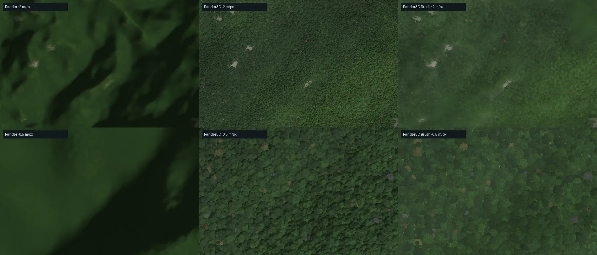

# Render3D and Render3D Brush

**Render3D** keeps the [Render](materials.md) material as its distant appearance and resolves a physical ground and a canonical forest as the pixel footprint shrinks. **Render3D Brush** draws the same forest with painted overhead crowns and shrubs. Both are display layers: they never change heights, climate, neural inference or server caches, and the server still renders `render` for PNG fallbacks and overviews.

They adapt the Render3D and Render3DBrush styles of Magna Urbis (`rust/bridge/terrainGround.ts`, `terrainForest.ts`, GPL-3.0), whose own Render material is a port of this repository's. The shader code is not shared: Magna Urbis renders one finite map with WebGL2 and a CPU forest raster for a single climate preset, while Neural Earth streams planetary WebGPU tiles with a spatial seasonal climate. The overhead brush atlas is shared unchanged (see [Assets](#assets)).

## Levels of detail

| Footprint | Appearance |
| --- | --- |
| ≥ 32 m/px | Render's baked colour and relief light. The shoreline comes from the interpolated DEM. |
| 32 → 2 m/px | Per-pixel GGX lighting and the canonical forest replace Render progressively (half at 8 m/px). Stands first appear through a coarser, mean-preserving field mip. |
| ≤ 2 m/px | Stand patches, explicit crowns (2–16 m lattices), litter and cast shadows. Brush crowns become legible between 2 and 5 px of radius, analytic ones between 0.9 and 2 px. |
| < 1 m/px | Ground bands of 8 m, 2.2 m, 0.32 m (elliptical clasts) and 0.055 m enter as their wavelength exceeds the footprint. |

Render3D layers allow zooming to 1/128 m per pixel; other layers keep their limit of a quarter of the finest tile sample. Native coarse blocks (LOD ≥ 4) are far beyond the reveal and draw exactly as Render.

## Tile bake

Each fine tile is baked once per layer and setting, on the GPU, in the same compute pass that shades Render:

- **colour**: Render's land material, unlit, and its relief light in alpha. Submerged samples are evaluated as shore, so filtering never mixes water into beaches; the draw places the water itself.
- **guide**: the same Render surface without canopy and fully canopied, plus Render's macro woods coverage. Crowns and open ground are residuals of these colours, so the forest mean stays on Render's palette.
- **forest field** (RGBA8): canopy cover, potential height (0–50 m), needleleaf fraction and stand tone.
- **climate**: annual and coldest-season temperature at altitude, aridity ratio and sea ice.

These four layers cover the whole tile including its 24-sample halo, so crown candidates beside a tile edge read real neighbouring values. They are box-mipmapped (mean-preserving) and add about 2 MB per 304² tile to the GPU cache accounting.

### Forest field

The field follows Magna Urbis's model, with Neural Earth's material terms instead of a re-evaluated copy:

- **Climate**: the summer temperature at altitude is the growing-season proxy; Magna Urbis's continentality correction for its single annual preset is unnecessary. The aridity ratio is Render's (valleys gather water, ridges drain), modulated by a 9 km productivity noise.
- **Treeline**: cover fades between growing-season temperatures of 5 and 8.5 °C, roughened by 520 m noise and raised in valleys, after Körner & Paulsen (2004).
- **Stands**: domain-warped stand mosaic (2.4 km), disturbance (1.1 km), conifer admixture (1.8 km) and tone (1.3 km); bogs on wet cold flats; wet tropical stands vary in height and tone rather than opening.
- **Clearings**: 400 m and 200 m noise with a terrain bias (ridges and gentle ground open first), thresholded at the logistic normal quantile of the target opened share (`0.4 × clearings`, reduced by 85 % in wet tropics).
- **Eligibility**: cover and height carry Render's own rock outcrop (sharpened), steep-slope gate, perennial snow and summer treeline, evaluated on the same sample, so Render's rock-coloured slopes stay treeless at every zoom.

The **Forest cover** slider of Render multiplies the Render3D **Density** control (`c ← 1 − (1 − c)^density`).

## Per-pixel material

Coordinates are tile-local metres. For every lattice (forest noises, crown levels, the 56 m patch noise, ground bands), JavaScript splits the tile origin into an exact integer cell and a fraction in float64. The shader adds the local offset to the fraction only, so cells agree exactly between neighbouring tiles and sub-centimetre detail keeps f32 precision 20 000 km from the origin.

- **Ground**: four oriented bands with analytic gradients; bands narrower than the footprint are dropped and their slope energy widens the GGX roughness (a scalar LEADR-like variance). Rock, soil, grass and snow covers follow slope and climate. The BRDF is GGX with Smith visibility and Schlick Fresnel on linear albedo, after Filament.
- **Relief light**: Neural Earth's sun and a secondary fill light; the macro slope keeps Render's exaggeration at distance and a third of it near the ground (2× by default), so relief stays readable; ground grains and crowns remain physical.
- **Crowns**: two adjacent lattice levels whose union keeps the stand density (Monte-Carlo inverse of the jittered-lattice Boolean coverage). Each candidate decides everything at its fixed centre, including its climate, so no crown is sliced by a fragment-dependent input. Broadleaf crowns follow `r = (0.24 h + 1)(1 + 0.45 dry)` and needleleaf `r = 0.14 h + 0.9` (Jucker et al. 2017). Stand margins are denser and darker (Harper et al. 2005).
- **Brushes**: 48 overhead watercolour sprites (pines, broadleaf, tropical, dry trees, temperate and dry shrubs); shrubs are chosen by physical height below 3–5.5 m, never by screen size. Sprites are mirrored but not rotated, tinted by the crown colour and composed as a union of translucent layers.
- **Water**: depth colour, sea ice and Render's tint from the interpolated DEM, with an antialiased shoreline at every scale. Resolved crowns may overhang it.

The ground's open colour is the guide surface recoloured with the same ground detail. Magna Urbis transfers it as a colour ratio from Render's colour, which tinted rock magenta beside green woods.

Captured on the live application (seed 42, Orogen, tropical lowland near x = −16 250 km, y = −150 km; LOD −4 and −6 decoder refinement).

## Controls and links

Under **Rendering**, the **Render3D · ground and forest** group appears with either layer: **Detailed canopy** (off keeps the ground material and Render's macro woods), **Density** (0–200 %) and **Clearings** (0–100 %). Links store `forest=0|1` while a Render3D layer is shown, and `forestDensity` / `forestClearings` when they differ from 100 % and 45 %. Share codes carry them in the rendering recipe. Changing them rebakes only Render3D tiles.

## Assets

`web/forest-brushes.bin` is Magna Urbis's packed RG8 texture array (coverage, centred luminance; 48 layers of 128²), imported unchanged with `node tools/assets/import_forest_brushes.mjs`, which also writes the manifest and SHA-256 in `web/terrain_forest_brushes.js`. Artwork prompts remain with the source atlases in Magna Urbis. The atlas (750 KB) is fetched only when Render3D Brush is displayed; box mips are built once on the CPU, about 2 MB on the GPU.

## Performance

Measured with `node tools/benchmarks/benchmark_render_layer.cjs` (GPU pass timestamps; RTX 3090, headless Chromium/Dawn), on synthetic 304² tiles:

| Work | GPU time |
| --- | --- |
| Render3D bake (Render material, guide, field, climate, mips) | 0.43–0.56 ms per tile |
| Render tile shading, for comparison | 0.13–0.17 ms per tile |
| Render3D full-screen 1920×1080 draw at 16 / 4 / 1 / 0.25 / 0.02 m/px | 0.23 / 1.55 / 0.49 / 2.2 / 2.7 ms |
| Render3D Brush, same views | 0.23 / 0.25 / 0.36 / 1.3 / 1.7 ms |
| Render quads, same views | 0.01 ms |

Render3D shaders compile lazily on first use (0.7–1.5 s cold on this machine); tiles meanwhile display Render. The brush atlas loads separately and analytic crowns are drawn until it is ready. These are machine-specific measurements of the fixture, not frame-rate guarantees.

## Limits

- **Tile-dependent relief terms.** Valley, ridge and slope terms come from each tile's own heights and Gaussian blur, so the field can differ slightly across tile edges (≤ 15/255 on the regression fixture) and between LODs. A crown at a boundary can occasionally differ between neighbouring tiles, and crowns can change when a finer tile replaces its parent.
- **No riparian galleries or land use.** This layer does not yet use the hydrology network to place Magna Urbis's narrow riparian envelope, or rural occupation to shape forest cover.
- **Map-plane lattices.** Crowns and ground grains use map metres; on a planet they stretch with the equirectangular map toward the poles, and lattices meet with a seam at the antimeridian.
- **Ecology.** No succession, species composition or understorey; moisture is a terrain/climate proxy, and calibration rests on Magna Urbis's sixteen CHMv2 windows.
- **Material, not geometry.** Crowns and grains are shading on the 2D map and globe: no silhouettes, parallax or traced occlusion.

## Validation

`node --test tests/browser/test_terrain_render3d.cjs` checks exact lattice coordinates between neighbouring tiles, settings and links, the Render capture points, and on a real WebGPU device: Render3D within 1/255 on average of Render beyond 32 m/px, resolved crowns at 3.75 m tiles, identical repeated frames, brush loading, and the forest field across a shared halo. Without a WebGPU adapter it reports a skip.

## References

- Körner, C. & Paulsen, J. (2004). [A world-wide study of high altitude treeline temperatures](https://doi.org/10.1111/j.1365-2699.2003.01043.x). *Journal of Biogeography*.
- Jucker, T. et al. (2017). [Allometric equations for integrating remote sensing imagery into forest monitoring programmes](https://doi.org/10.1111/gcb.13388). *Global Change Biology*.
- Harper, K. A. et al. (2005). [Edge influence on forest structure and composition in fragmented landscapes](https://doi.org/10.1111/j.1523-1739.2005.00045.x). *Conservation Biology*.
- Dupuy, J. et al. (2013). [LEADR mapping](https://perso.liris.cnrs.fr/victor.ostromoukhov/publications/pdf/SAsia2013-LEADR.pdf). *SIGGRAPH Asia*.
- [Filament physically based rendering](https://google.github.io/filament/main/filament.html).
- Brandt, M. et al. (2026). [CHMv2: Improvements in Global Canopy Height Mapping using DINOv3](https://arxiv.org/abs/2603.06382) — Magna Urbis's calibration sample.
